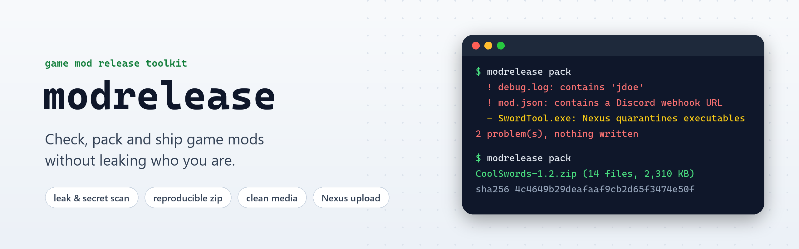

Config files and logs in a mod archive keep `C:\Users\yourname\...` paths, tools and their `.pdb` files keep the
folder they were built in, screenshots keep the camera and the GPS position, and a zip made in Explorer keeps the
time you touched every file. A Discord webhook or a GitHub token in a config is worse: anyone who downloads the mod
can use it. modrelease finds all of that before you upload, then packs the release.

```
pipx install modrelease        # or: pip install modrelease
modrelease check MyMod/
modrelease pack MyMod/ -o MyMod-1.0.zip
```

| Command | What it does |
|---|---|
| `check` | Looks for personal data, secrets and risky files in a folder, files or a finished zip |
| `pack` | The same check, then a reproducible zip and its `.sha256` |
| `clean` | Screenshots and videos without EXIF, GPS, tags or encoder settings |
| `diff` | Files added, removed and changed between two release zips |
| `vt` | The VirusTotal result for a file, and which engines flag it |
| `nexus` | Uploads the zip as a new version of a file on Nexus Mods |
| `appeal` | Writes the email that gets a quarantined Nexus file reviewed |
| `guard` | Git hooks that keep your real name, email and time zone out of your alias's commits |

Settings can live in a `modrelease.toml` next to the mod, and there is a GitHub Action for releases on every tag.
The full guide, a demo and the source are on [GitHub](https://github.com/ayokiru/modrelease).
