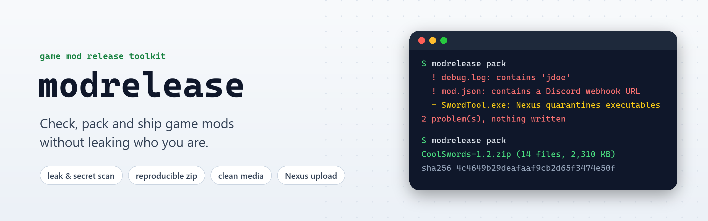
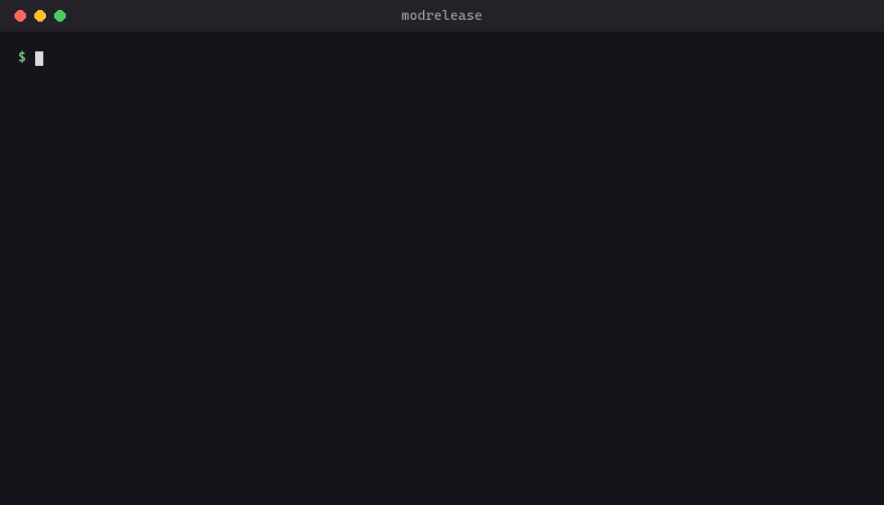

<picture>
  <source media="(prefers-color-scheme: dark)" srcset="docs/banner-dark.png">
  
</picture>

<p align="center">
  <a href="https://github.com/ayokiru/modrelease/actions/workflows/test.yml"></a>
  
  
  <a href="#github-action"></a>
  <a href="LICENSE"></a>
</p>

<p align="center">
  <a href="#quick-start">Quick start</a> &nbsp;·&nbsp;
  <a href="#commands">Commands</a> &nbsp;·&nbsp;
  <a href="#modreleasetoml">Config</a> &nbsp;·&nbsp;
  <a href="#github-action">GitHub Action</a> &nbsp;·&nbsp;
  <a href="#limits">Limits</a>
</p>

Config files and logs in a mod archive keep `C:\Users\yourname\...` paths, tools and their `.pdb` files keep the
folder they were built in, screenshots keep the camera and the GPS position, and a zip made in Explorer keeps the
time you touched every file. A Discord webhook or a GitHub token in a config is worse: anyone who downloads the mod
can use it. modrelease finds all of that before you upload, then packs the release.

<table>
  <tr>
    <td width="33%" valign="top">
      <br>
      <b>Leak and secret scan</b><br>
      Your login, PC name and git email, Discord webhooks, tokens, private keys, EXIF, names that break on Windows.
    </td>
    <td width="33%" valign="top">
      <br>
      <b>Reproducible zip</b><br>
      Fixed dates, sorted entries and a SHA-256 next to it. The same files always give the same bytes.
    </td>
    <td width="33%" valign="top">
      <br>
      <b>Clean screenshots and videos</b><br>
      Strips EXIF, GPS and editor tags, and the x264/x265 settings from trailers without re-encoding them.
    </td>
  </tr>
  <tr>
    <td valign="top">
      <br>
      <b>Release diff</b><br>
      Files added, removed and changed between two releases, for the changelog and for strays.
    </td>
    <td valign="top">
      <br>
      <b>VirusTotal and quarantine</b><br>
      Which engines flag the zip, and the support email Nexus asks for when it quarantines a file.
    </td>
    <td valign="top">
      <br>
      <b>Nexus upload and CI</b><br>
      A new file version on Nexus Mods from the command line or a GitHub Action on every tag.
    </td>
  </tr>
</table>

## Quick start

```bash
pipx install git+https://github.com/ayokiru/modrelease   # Python 3.11+

modrelease check MyMod/                                   # what would leak
modrelease pack MyMod/ -o MyMod-1.0.zip                   # check, then a clean zip and MyMod-1.0.zip.sha256
```

Videos need `ffmpeg` on PATH. Everything else is pure Python.

<p align="center"></p>

## Commands

| Command | What it does |
|---|---|
| [`check`](#check) | Looks for personal data, secrets and risky files in a folder, files or a finished zip |
| [`pack`](#pack) | The same check, then a reproducible zip and its `.sha256` |
| [`clean`](#clean) | Screenshots and videos without EXIF, GPS, tags or encoder settings |
| [`diff`](#diff) | Files added, removed and changed between two release zips |
| [`vt`](#vt) | The VirusTotal result for a file, and which engines flag it |
| [`nexus`](#nexus) | Uploads the zip as a new version of a file on Nexus Mods |
| [`appeal`](#appeal) | Writes the email that gets a quarantined Nexus file reviewed |

### check

```
modrelease check MyMod/            # a folder, files, or a finished zip
```

```
  ! config/settings.ini: contains 'jdoe'
  ! config/discord.json: contains a Discord webhook URL: remove it and revoke it, it is no longer secret
  ! media/preview.jpg: image metadata (EXIF or text chunks): run `modrelease clean` on it
  - Binaries/MyMod.pdb: debug symbols: players don't need them and they hold the build folder path
  - tools/MyTool.exe: executable: Nexus quarantines these for a manual review (`modrelease appeal`)
3 problem(s)
```

<details>
<summary>What stops a release (<b>!</b>) and what is only a note (<b>-</b>)</summary>

<br>

Problems:

- your login, computer name, home folder and git name and email (UTF-8 and UTF-16, any case), plus anything you add
  with `--term "My Real Name"`
- tokens and keys: Discord webhooks, GitHub, AWS, Google and Slack tokens, private keys (the finding names the kind
  of token and leaves its value out of the output)
- images with EXIF or text chunks
- file names that differ only in case, or that Windows can't create (`aux.txt`, `a:b.ini`, a trailing dot)

Notes: other people's user folders (often a library's build machine path), debug symbols (`.pdb`), source files
(`.psd`, `.blend`, `.uproject`), engine and IDE folders (`Saved/`, `Intermediate/`, `.vs/`), very long paths,
non-Latin file names and the files Nexus will quarantine.

</details>

### pack

```
modrelease pack build/MyMod -o MyMod-1.0.zip --prefix "Game/Content/Paks/~mods" --exclude "*.psd"
```

Runs the check and stops on a problem (`--force` writes the zip anyway). Every file gets the same fixed date
(1980-01-01, or `SOURCE_DATE_EPOCH`), entries are sorted, paths use forward slashes and `Thumbs.db` or `.DS_Store`
stay out, so the same files always give the same bytes. `--prefix` puts the files in the folder the game expects,
so players can extract the zip straight into the game folder.

### clean

```
modrelease clean screenshots/ trailer.mp4 -o upload/
```

<details>
<summary>What gets removed</summary>

<br>

Images are rebuilt from their pixels, which drops EXIF, GPS, XMP, ICC profiles and PNG text; phone photos keep
their rotation. JPEG and WebP get encoded again at quality 95. Videos are copied without re-encoding, minus
container tags, chapters, the `Lavf` muxer string and the x264 or x265 settings block. `--no-audio` drops the
sound track.

</details>

### diff

```
modrelease diff MyMod-1.0.zip MyMod-1.1.zip
```

```
  + Paks/zzz_MyMod_Patch_P.pak
  - docs/old_readme.txt
  ~ Paks/zzz_MyMod_P.ucas (2,310 KB -> 2,402 KB)
1 added, 1 removed, 1 changed, 12 unchanged
```

Reads only the zip headers, so it is instant on big releases.

### vt

```
set VT_API_KEY=...        # free key: virustotal.com/gui/my-apikey
modrelease vt MyMod-1.0.zip --upload
```

Shows how many engines flag the file and which ones. `--upload` sends files VirusTotal has not seen yet, big ones
included. Without a key you get the link to look it up by hand.

### nexus

```
set NEXUS_API_KEY=...     # from the API keys page of your Nexus account settings
modrelease nexus MyMod-1.1.zip --file-id 12345 --mod-version 1.1 --archive-old
```

Uploads the zip as a new version of a file that is already on your mod page, through the Nexus Mods v3 API (the
same steps as Nexus's own upload action). `--mod-id` and `--changelog` add a changelog entry. The Nexus upload API
is still in beta.

### appeal

```
modrelease appeal MyTool-1.0.zip --mod https://www.nexusmods.com/game/mods/123 --user MyNick ^
  --source https://github.com/me/mytool --build "pip install -r requirements.txt" --build "python build.py"
```

Prints the email for `support@nexusmods.com`: the file, the VirusTotal result with the names of the engines that
flag it, the programs in the archive, the source link and your build steps. Send it from the address on your
Nexus account.

## modrelease.toml

Put the settings next to your mod and a release is `modrelease pack` and `modrelease nexus`. Paths are relative to
the file; command line options win over it.

```toml
source = "build/MyMod"
output = "dist/MyMod-{version}.zip"
version = "1.1"
prefix = "Game/Content/Paks/~mods"
exclude = ["*.psd", "Saved/", "docs/*.md"]   # *.x: any file name, Dir/: a folder anywhere, a/b: from the root
terms = ["My Real Name"]                     # more strings that must never ship

[nexus]
file_id = 12345
mod_id = 678
category = "main"                            # main, optional or miscellaneous
```

## GitHub Action

Pack on every tag, attach the zip to the GitHub release and send it to Nexus:

```yaml
on:
  push:
    tags: ["v*"]
jobs:
  release:
    runs-on: ubuntu-latest
    permissions:
      contents: write
    steps:
      - uses: actions/checkout@v4
      - uses: ayokiru/modrelease@v0.2.0
        with:
          args: pack --mod-version ${{ github.ref_name }}
      - uses: softprops/action-gh-release@v2
        with:
          files: dist/*
      - uses: ayokiru/modrelease@v0.2.0
        with:
          args: nexus --mod-version ${{ github.ref_name }} --archive-old
        env:
          NEXUS_API_KEY: ${{ secrets.NEXUS_API_KEY }}
```

On a CI runner the login and computer name belong to the build machine, so only `terms` and `--term` are searched
for there.

## Limits

<details>
<summary>What the check can't see</summary>

<br>

- Text hidden in compressed data (game paks, nested archives) is not unpacked, so the check cannot see it.
- The check knows your login and git identity on this PC. Names from another PC or an old account need `--term`.
- Short logins are common words inside programs, so a login of up to 3 letters counts only inside a path, and one
  of 4 or 5 letters only as a whole word. A login like `mike` can still turn up in a third-party DLL's credits;
  check those findings and pack with `--force`.
- Tokens are found by their known shapes. A password typed into a config file has no shape, so read your configs.
- H.265 videos lose their HDR metadata in `clean`, since it sits in the same kind of block as the encoder settings.

</details>

---

<p align="center">
  <sub>MIT license · icons from <a href="https://lucide.dev">Lucide</a> (ISC) · made by <a href="https://github.com/ayokiru">ayokiru</a></sub>
</p>
